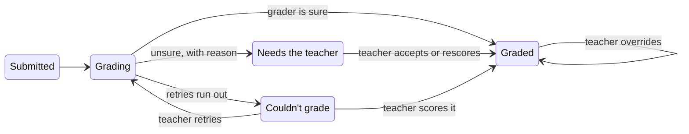

# Goblins Auto-Grader PRD

2026-10-14 · Kincaid O'Neil

Copied from the Claude Docs PRD on 2026-10-15. This file is now the source of truth; change it through PRs.

## Objective

**Context:** this is Kincaid's take-home in the interview process for a product engineer role at Goblins. Agents build it; Kincaid oversees the work and is accountable for it.

**The real goal:** deliver a thoughtful, polished deliverable that fulfills the brief, so that Kincaid is offered the role. Every agent working on this should hold that bar. Reviewers will judge product sense, design quality, reasoning about scale and cost, and how clearly decisions are explained. Good enough is not enough.

**The business goal:** get more teachers to activation. Goblins retains students extremely well once a teacher assigns work (D90 up to 82%), but teachers stall at creating the first assignment and handing out access codes. Goblins is free for teachers and sells Goblins Max per school or district, so growth starts with individual teachers. The auto-grader is a growth product: generous enough to give away, useful enough to build a habit, share-worthy enough to spread, and one click from full Goblins.

**The product:** a free auto-grader. A teacher uploads the worksheet they were going to hand out anyway, students show their work on a whiteboard, and the teacher gets a graded class and a report without grading anything. Its main job is to save teachers hours of grading.

**Product goals**

- **Saves time.** A teacher goes from a worksheet they already have to a launched assignment in under 5 minutes, and afterward only looks at the grades the grader flagged.
- **Accurate, for teachers and students.** Grades agree with what a careful teacher would give, and no student loses points because the grader misread their work. The teacher can always see what the grader read and why it gave each score.
- **Cheap for Goblins.** Cost is measured per grade, since that's what evals can measure, and reported per teacher per month, since a free growth product's cost is an acquisition cost. The target is about $0.001 per grade: roughly $5 per teacher per month for a teacher with 130 students who grades one 10-problem assignment a week. Evals confirm it, and the writeup reports it at each scale.
- **Kind to students.** Students enjoy using it, and it never makes them anxious.
- **Reliable under load.** Every submission ends up graded or visibly needing the teacher; none are lost. A load test that anyone can re-run against the public deploy finds where the pipeline slows and where it breaks, and supports a written ship / no-ship call.
- **Leads to Goblins.** The final report makes a teacher want to try Goblins with feedback on, and to share it with their administrators.

**Deliverables:** a publicly hosted app, the repo, the load-testing code, a short statement-of-confidence writeup, a README that explains the decisions made and deferred, and a 2–3 minute walkthrough recording.

The original assignment is in [the brief](#appendix-the-brief) at the end of this file. Where this PRD is silent, the brief decides; where both are silent, make the call and record why.

## Scope

We ship one complete loop, from a teacher's worksheet to a trusted report that points at Goblins, and cut what doesn't serve it.

| In scope | Out of scope | Why it's out |
|---|---|---|
| Landing page with an upload drop zone | Marketing site beyond one page | One page has to sell it; more is distraction |
| Worksheet upload, extraction, and editing by text or chat | A form for typing problems from scratch | Teachers already have worksheets; templates cover the empty state |
| Template assignments from real worksheets | A template library or marketplace | A few good templates are enough for first use and the demo |
| Teacher Google sign-in | Student accounts, Clever, Google Classroom sync | Student identity rests on the teacher in the room |
| Join with a code and a name, avatars | Rosters, device approval | Students could still swap places; only real auth prevents that, so approvals add friction without security |
| One problem at a time on a whiteboard | Student re-attempts; writing directly on the worksheet | Retries turn a test into guess-and-check; a shared surface makes per-problem grading much harder |
| Grades the teacher can check, with flags when the grader is unsure | Numeric confidence scores | Poorly calibrated, and an explicit flag is more actionable |
| Live dashboard, score overrides, final report | Grade export, LMS sync | Follow-up once teachers come back |
| Goblins CTA and a shareable report link | Building the feedback experience | It already exists in Goblins |

## User flows

These flows are the core of the PRD. Each lists the steps, what the user sees, and the edge cases; implementation is up to the workstreams.

### Landing page

The landing page has one job: make a teacher drop in a worksheet within a minute of arriving.

1. A teacher arrives from a shared report, a colleague or search.
1. The page says what it does in one line (grade your next test for you), shows a short visual of a graded worksheet, and offers a drop zone.
1. The teacher drops a worksheet or picks a template. Setup starts right away, with no sign-in.
1. Sign-in with Google (through Clerk) is asked for only when the teacher launches, so nothing they've done is lost.

**Edge cases**

- An unsupported file type or an unreadable photo gets a clear message and a suggestion to try a template.
- A returning signed-in teacher lands on their assignments instead.

### Assignment setup

The teacher reviews what the grader will know, in plain language, and fixes it by typing or by asking.

1. The teacher's worksheet is turned into problems, each with its text, an answer key and a rubric.
1. Rubrics are point lines in plain language, like an AP scoring guide: “1 pt: correct setup. 1 pt: correct answer. Accept equivalent forms.”
1. The review screen shows the problems in order, each with its text and rubric, with the original pages alongside.
1. The teacher edits any text directly, or uses the chat panel: “make problem 3 worth 4 points,” “accept unsimplified fractions,” “you missed problem 6.”
1. The teacher names the assignment and moves on to launch.

**Requirements**

- The grader must have everything it needs to grade each problem correctly, including diagrams in geometry problems, and the teacher must be able to see what that is.
- Problems that depend on earlier ones (“2b uses your answer to 2a”) are linked, and the rubric gives follow-through credit: a correct method using the student's own wrong earlier answer earns the method points.
- A problem that runs across two pages is one problem.
- How extraction works, what the grader receives (text, a description, the page image) and which models run are decided by the AI-quality workstream from eval results, not by this PRD.

**Edge cases**

- A missed or merged problem is fixed by chat or by editing.
- Non-math worksheets are out of scope; the app says so instead of guessing.

### Launch and join

Joining works like Kahoot or Blooket: a code on the projector, a name, and the teacher in the room as the check on identity.

1. The teacher signs in with Google if they haven't and launches.
1. The projector view opens in its own window: a large join code, a QR code, and a lobby where each student appears with their avatar as they join.
1. A student scans the code or types it in, then enters their first name and last initial.
1. The student gets a randomly assigned avatar and lands on the first problem when the teacher starts the session.
1. Once the session starts, the projector shows only time remaining and one shared progress visual for the whole class: no names, no per-problem counts.

**Names**

- One rule: entering the same name in the same session, on any device, resumes that student.
- Names match regardless of case, spacing and punctuation, so “maya r” resumes “Maya R.”
- If two students end up merged, or a name is mistyped, the teacher can rename or split students from the dashboard.

**Known limitation:** a student can join as someone else, and students can swap places without the teacher knowing. Only real student accounts prevent that, which is out of scope. The lobby on the projector shows every name, so obvious mistakes are visible to the room.

**Edge cases**

- A student who closes the tab and returns, on any device, resumes where they left off.
- A student who joins late joins normally.
- When the teacher ends the session, joins and submissions stop; grading in progress still finishes.

### Student work

Students work one problem at a time, each on its own whiteboard, and never wait on the grader. This matches the brief (a score after each problem) and how Goblins works today.

1. The student sees the problem on the left and a whiteboard on the right. On a narrow screen they stack. A “See worksheet” button shows the original page.
1. They draw their work and press Submit.
1. The screen confirms the submission and plays a short transition, about 1.5 s, into the next problem. If the grade arrives during the transition, the score shows on it; if not, the next problem opens and the score fills in on the progress strip.
1. A progress strip along the top shows every problem and doubles as navigation. Scores fill in as grading finishes, a few seconds later.
1. After the last problem, the student sees a summary: problems done and the scores that are in. Copy is warm and focused on effort.

**Edge cases**

- The student can jump to any unsubmitted problem from the progress strip. A submitted problem is locked.
- An empty whiteboard can't be submitted.
- A grade that needs the teacher shows as “your teacher will check this one,” never as an error.
- If the connection drops, the whiteboard keeps the work and submits when the connection returns.

### Grading

Every grade either stands on its own or asks the teacher, and the teacher always has the last word.

A grade's five states. The teacher can always resolve a grade the model could not.

Only Graded shows a score to the student; the other states show “your teacher will check this one.”

**What the grader sees:** the problem text and diagram description, the rubric, the student's whiteboard, and for a dependent problem, the student's earlier work it depends on. It never sees the worksheet image unless the teacher marked the problem that way.

**What the teacher can see for every grade:** what the grader read from the whiteboard, the points for each rubric line, and a one-line reason. Whether that takes one model call per submission or one per point line is for the evals to decide.

**When the grader is unsure,** for example the rubric doesn't cover what the student did or the handwriting is unclear, it still gives a best-guess score but marks the grade as needing the teacher, with the reason. The teacher either accepts the best guess or enters their own score.

**When grading fails** after automatic retries, the grade shows as “couldn't grade.” The teacher can retry it or score it themselves.

**Later, not in the first build****: rubric questions.** When the teacher opens a problem with several flagged grades, one model call reads their reasons and groups them: “5 students left 6/8 unsimplified. The rubric doesn't say whether that's full credit.” The teacher answers in the chat panel. The answer becomes a rubric clarification, and those flagged submissions are graded again. Grouping happens when the teacher looks, so grading calls never coordinate with each other.

Students see a score only once a grade is final for them: graded by the model, accepted or scored by the teacher, or overridden. Until then they see “your teacher will check this one.”

Whether a grade is waiting in the queue or its model call is in flight is a pipeline concern, not a product state. The load-test reports show queued and in-flight counts separately.

### Live dashboard

During the session, the teacher's dashboard updates by itself and puts anything that needs them at the top.

1. The top of the page lists what needs the teacher: grades to check and grades that failed.
1. Below is a grid of students (with avatars) by problems. Each cell shows not started, submitted, graded (colored by score), needs you, or couldn't grade.
1. Opening a cell shows the whiteboard, what the grader read, the points per rubric line, the reason, and controls to accept, rescore or retry.
1. The teacher can override any score at any time, and rename or split students. The student sees the change.
1. The teacher ends the session from here, which produces the report.

**Privacy on a projected laptop**

- The projector view is a separate window, as in Pear Deck and Nearpod, so a teacher with an extended display keeps the dashboard private.
- Many teachers mirror their screen instead. The dashboard has a one-click “hide names and scores” toggle, which stays on until the teacher turns it off.

**Edge cases**

- The dashboard works on a second device; the teacher signs in there with Google.

### Report and the Goblins pitch

The report is the payoff: it saves the teacher an evening of grading, shows exactly where the class struggled, and offers Goblins as the fix.

1. When the teacher ends the session, the report opens. It stays available from their assignments afterward.
1. A class summary: completion, the score distribution, and the average per problem.
1. Where students struggled: for each weak problem, the common mistakes in plain language, drawn from the graders' reasons, with the students who made them.
1. **Primary CTA:** “Give these 6 students practice on this in Goblins.” One click creates a Goblins assignment on the same skills with real-time feedback on, for exactly those students. It works on Goblins' free teacher tier, so it gets the teacher to activation with no purchase.
1. **Secondary CTA:** “Share this report.” A view-only link for a colleague, department head or administrator.
1. The shared report page hides student names, shows the class-level results, and pitches Goblins to the viewer: the free tier to other teachers, Goblins Max to administrators, with a way to contact Goblins.

**Edge cases**

- If the whole class did well, the CTA becomes extension practice instead of remediation.
- Grades still waiting on the teacher show as pending in the report, and the report updates when they're resolved.

## Fixed decisions

These choices are settled; everything else about implementation is up to the workstreams, who record their calls in the decision log.

**Changed since kickoff** (details in the [decision log](decisions.md)): grade jobs moved from Vercel Queues to Upstash QStash, because Vercel Queues measured 129 s against QStash's 32 s for the same 60 jobs. Sync moved from Electric Cloud to Electric self-hosted on Fly.io, because Electric Cloud is winding down.

| Area | Decision | Why |
|---|---|---|
| Repo | pnpm monorepo, one package per area (app, UI, domain, grader, evals, simulator, load test) | Each workstream mostly owns one package, so streams work in parallel without colliding |
| App | TanStack Start on Vercel, Effect for server code | Preferred stack; Goblins builds in Effect |
| Sync | Electric (Electric Cloud) with TanStack DB; writes go through server functions; a server proxy decides who can read which data | Real-time screens with a free tier; we own the write path; sync is plain HTTP, so it's easy to load test |
| Database and files | Postgres from Neon and Vercel Blob for whiteboard images, both provisioned through Vercel | No extra accounts; images stay out of the synced tables |
| Grading jobs | Vercel Queues in push mode: each grade is a message delivered to a Vercel Function, with a concurrency cap matched to the model provider's limits | No extra host or vendor; redelivery on failure built in; about $0.60 per million operations, so repeated load tests cost cents. Delivery is at-least-once, so grade writes must be idempotent. The first slice verifies the concurrency cap works; if it doesn't, the fallback is a Postgres jobs table worked by functions with a cron sweeper. |
| Teacher auth | Clerk development instance with Google sign-in | Uses Clerk's shared Google credentials, so no Google Cloud setup; enough for a demo |
| Models | OpenRouter behind one interface with a real and a mock implementation; every call logged with latency, status, tokens and cost | Swappable for evals and load tests; the log feeds cost tracking, projections and failure replay |
| UI | Shared UI package on Base UI with Storybook, styled in Goblins' design language | Consistent, reviewable components for every stream |
| Evals | A separate package, independent of the app | They choose models and inputs, and justify the cost numbers |
| Schema and migrations | Drizzle schema in the domain package, queried through @effect/sql-drizzle; Drizzle Kit generates plain SQL migrations, checked in and applied automatically on deploy; each Vercel preview gets its own Neon database branch; logical replication turned on in Neon | One schema shared by every stream; Effect-native queries with typed errors; the same schema generates the TanStack DB collection types; Electric needs only plain Postgres; isolated databases for every PR's E2E run |

The vendors are Vercel (app, database, files, queue), Electric Cloud, Clerk and OpenRouter.

## Quality bar

The work is done when the evidence below exists, not when an agent says it works.

**End-to-end tests over unit tests.** Playwright, with a teacher, a projector and several students in one test, against each preview deploy, using a mock model with fixed grades. Unit tests only where logic is dense. Every user flow above has at least one test, covering at minimum: setup by chat, joining and resuming by name, submitting and moving on, the dashboard updating live, a flagged grade being accepted, a failed grade being retried, and an override reaching the student. A failing suite blocks merge. UI changes are also checked by screenshot.

**Class simulator.** A tool that drives N simulated students through a real session, submitting pre-drawn whiteboards at a realistic pace. It serves three purposes:

- E2E at scale: the dashboard and projector stay correct and live with a full class, and with many classes.
- The recorded demo: a dashboard filling up in real time, reproducible on demand.
- The client side of the load test.

**Evals.** The AI-quality workstream owns them and uses them to decide how extraction works, what the grader receives and which models run.

- How the datasets are built is the stream's call, with two constraints: the correct scores can't come only from a model, and a person reviews any ground truth the stream isn't sure of.
- The grading set covers what students actually do: correct work, partial credit, common mistakes, messy handwriting, blank work, and geometry with diagrams. Sub-workers of the stream generate the whiteboards, and the class simulator uses the same set. Kincaid draws 5–10 by hand to check that the generated ones look like real student work.
- Reports cover agreement with the correct scores, how often grades get flagged, cost per grade against the target, and latency.
- Extraction is evaluated too: problems found, text accuracy, dependent problems linked.

**Load test.** Runs against the public production deploy with only the model mocked, so it costs nothing to repeat. Anyone with the repo, Goblins included, can re-run it with one documented command. Load-test requests carry a header that routes them to the mock model and tags their data, so it stays out of real dashboards and is deleted after the run.

- The mock replays real behavior: latency and errors sampled from logged model calls, plus named scenarios (rate-limit storm, a provider down for 5 minutes, latency doubling) and replay of a recorded window.
- The load shape is a testing day: classes of about 30 starting within 2 minutes of the bell, about 10 submissions per student over 20–40 minutes, with live dashboards and progress strips subscribed throughout. The run ramps: it starts at about 1,000 students and adds classes in steps until a criterion below fails or a vendor limit is hit.
- It reports submit latency, time from submit to the grade appearing on the dashboard, queued and in-flight grades, errors by type, lost submissions, database and sync load, and the share of grades that arrive during the between-problem transition. For each step it marks every criterion pass or fail, and it names the step where each first failed and the component that failed first.

**Ship / no-ship criteria** (judgment calls, each with its reason; confirm before the first run)

| Metric | Must hold at each step | Why this bar |
|---|---|---|
| Lost submissions | 0 | A lost submission is a student's work gone; no rate of that is acceptable |
| Submit latency p99 | < 1 s | Submitting should feel instant even at the bell; about 1 s is where a click stops feeling responsive |
| Submit to grade on dashboard, p95 | < 30 s | Students have already moved on, so this bar is for the teacher; within half a minute still feels live |
| Grades that fail, normal conditions | < 0.1% | About one per 1,000 grades: a class of 30 doing 10 problems hits one every third test or so, and the teacher grades it by hand |
| Grades that fail, provider down 5 min | 0% (delayed, not failed) | A short outage should only delay grades; the queue absorbs it |

The highest step where every criterion holds is the system's capacity, and that is the number the writeup states. Ship means the capacity is at least 1,000 students in one testing window.

**Model budget.** The OpenRouter key holds $20 for the whole project. Development and CI use the mock model by default; real calls need an explicit flag. A usage report reads the call log and OpenRouter's key usage, and the orchestrator checks it at every checkpoint.

| Use | Budget |
|---|---|
| Evals | $8 |
| Extraction and prompt development | $4 |
| Production and demo | $4 |
| Latency calibration | $2 |
| Reserve | $2 |

**Scale and cost.** The writeup projects throughput and cost at 1,000, 10,000, 100,000 and 1M students, using measured cost per grade from the evals, and says what changes at each step. Past 10,000 students, model cost and provider capacity are expected to limit us before our own infrastructure does.

**Writeup.** A short statement of confidence: what the system reliably handles today (the capacity the ramp found), backed by load-test reports, and what we'd do at each scale step.

**README.** It opens with what the app does and how to run the app, evals and load test. Then it lists the main decisions, one line of reasoning each, and what was deferred and why, drawn from the decision log. The brief grades “how clearly you explain the decisions you made and the ones you chose to defer.”

## Execution plan

One orchestrator session runs the project. It starts a separate Claude Code session for each workstream and coordinates them, so many streams run in parallel from the first hour. The split below is a suggestion: the orchestrator may merge, split or reorder streams, and records why in the decision log.

**Kickoff.** The orchestrator's first act is to copy this PRD, including the brief, into the goblins-takehome repo as docs/prd.md and link it from AGENTS.md. From then on the repo copy is the source of truth: sessions read it, and changes to it go through PRs like any other change. This doc stops being edited.

**Orchestrator**

- It plans, starts workstream sessions, verifies their work and reports. It writes no product code.
- It owns the PRD, a decision log (one line of reasoning per decision) and the task board.
- Every brief it gives a session states the goal, the package or files the session owns, the flows it serves, what done means, and what to escalate. Every brief points to the PRD and restates the objective: this work is judged as a hiring deliverable.
- Done means evidence: CI and E2E passing, screenshots, a preview URL. A session's report alone is not done.
- Follow-ups go to the session that has the context, not a new one.
- At most about 6 sessions write code at once, each in its own worktree. Read-only work, such as research, can run alongside freely.

**Workstream sessions**

- Each workstream is its own Claude Code session, named for its stream so Kincaid can find it.
- A session may use subagents, or start further sessions, for smaller pieces of its stream. The web app lead is expected to.
- Sessions never stop to wait for an answer. They record an assumption and keep going. Questions for Kincaid go to the orchestrator, which batches them, each with a recommendation.

**Talking to sessions directly**

- Kincaid can open any session and give feedback there, without going through the orchestrator.
- The session acts on that feedback. If it changes a decision, the scope, or another stream's work, the session tells the orchestrator, which updates the decision log and any affected sessions.

**Suggested workstreams**

The monorepo's packages set the boundaries: each stream mostly owns one package.

| Stream | Delivers | Can start |
|---|---|---|
| Web app lead | Teacher, student and projector apps, and the dashboard. Its first PR is the shared domain package the other streams build on. | Now |
| Design system | Goblins' design language captured from their public site; tokens, Base UI components and Storybook in the UI package; avatar set | Now |
| Landing page | The page and its drop zone | Once tokens exist |
| Templates | 3–5 real worksheets, including geometry, with licenses that allow use, such as openly licensed curricula | Now |
| AI quality | Extraction, rubric drafting, chat editing and grading prompts; the eval datasets, including generated whiteboards, and the harness; model and input choices; cost per grade and scale projections | Once templates exist |
| Grading pipeline | Queue consumer, model interface, retries, call logging, usage report | Now, against stubs |
| Mock model and replay | Sampled latency and errors, named scenarios, replay of recorded windows | Now |
| Class simulator | Simulated students submitting pre-drawn whiteboards; used by E2E, the demo and the load test | Once the domain package exists |
| Load test | Testing-day load on the simulator, reports with pass/fail per criterion | Now locally; for real once the pipeline is deployed |
| Report | Class summary, common mistakes, Goblins CTA, shareable page | Now, against fixture data |
| Infra and CI | Accounts wiring, environments, CI, preview deploys, the E2E harness | Now |
| Writeup and recording | Statement of confidence, walkthrough script | After the first full load run |

**Git, PRs and deploys**

- The repo is goblins-takehome. Each task gets its own worktree, branch and small PR against main.
- Each agent owns its PR until it merges, and never waits for Kincaid:
    1. Review its own diff with a code-review pass before opening the PR.
    1. Wait for CI (typecheck, lint, tests, and E2E against the Vercel preview) and the automated Codex review.
    1. Address every review comment, fixing or replying with a reason. Resolve them.
    1. Rebase on main and merge once CI is green and the comments are addressed.
- The orchestrator doesn't merge. It sequences work so two agents never own the same files at once, and settles conflicts when they happen.
- Merging to main deploys to production automatically.

**Environment setup**

The Infra and CI stream owns setup. At kickoff it sends Kincaid one list of everything only a person can do: accounts to create, command-line tools to sign in to, and keys to put in the local secrets file (never committed, never pasted into chat). Agents don't create accounts, sign in or type keys into web forms. Everything after that, they do through command-line tools: linking the Vercel project, adding Neon, Blob and Queues through Vercel, and setting environment variables and CI secrets from the secrets file.

| Service | Kincaid does | Agents do |
|---|---|---|
| GitHub | Already set up, with Codex reviews | Create the repo, CI and secrets with the `gh` CLI |
| Vercel | Sign in to the CLI | Link the project; add Neon, Blob and Queues; set environment variables |
| Electric Cloud | Create the account and copy the source credentials into the secrets file | Configure the proxy and connection |
| Clerk | Create a development instance with Google sign-in on; copy its keys into the secrets file | Wire up auth |
| OpenRouter | Copy the emailed key into the secrets file; check the $20 limit | Usage reporting and spend checks |

**Where Kincaid is involved**

By default, no workstream waits on Kincaid. Kincaid will still review closely, critique and redirect work often; treat that feedback as top priority, not as a gate. The checklist below is what only Kincaid can do.

- One-time setup at the start, from Infra and CI's list: accounts, CLI sign-ins, keys, spending caps
- Review any eval ground truth the AI-quality stream isn't sure of
- Review screenshots of each flow and the design language
- Confirm the ship / no-ship criteria before the first load run
- Approve anything that costs money, including asking Goblins to pay for a service
- Write the statement of confidence and record the walkthrough

The orchestrator reports at four checkpoints: after the first working slice is deployed, after the first eval report, after the first load run, and before submission. Each report lists what's done, what's in progress, model spend against budget, assumptions to confirm, and decisions needed.

## Appendix: the brief

The original brief, verbatim. Agents treat this as the reference when the PRD is silent.

### Goblins Takehome

Once teachers put Goblins in the hands of students, there is no going back. Our D90 retention is extremely high, as much as 82% for some cohorts, which is unprecedented across edtech. The tricky part is getting teachers to our point of activation: we need to get teachers over the friction of making the first assignment and giving kids access codes. We’ve gotten quite good at this, but we can always be better, and one way we can do so is to provide value to teachers outside of the product itself, via a “growth product”.

This “growth product” is something we can give away generously that's still worth a teacher's time. It also should be valuable enough that it can build real habit on their own, and it should be discoverable and share-worthy, driving traffic to the main Goblins experience, which is a simple button-click away.

The bet: an **auto-grader**.

It's the same Goblins experience, still with the analytics, but with real-time feedback turned *off*. Teachers spend enormous amounts of time grading, and nothing like this exists in the market, so even with feedback off, we expect it to keep teachers coming back.

There's a catch. Grading runs the model on every submission, so at any real volume it costs money. That makes this two problems at once: a product one (how accurate is the auto grader w/ cheaper models?) and an infra one (can we trust it under load? and can we even test that without torching our model budget?).

#### How the feature works

1. A teacher creates an assignment and shares it with students.
2. A grading rubric is generated for the assignment, and the teacher should be able to edit it.
3. Each student has a whiteboard available to show and submit their work.
4. After submitting a problem, the student is shown their score and continues to the next, until the assignment is complete.
5. The teacher receives a report showing each student's progress and grades.
6. Everything persists: a teacher (or student) can return on a different browser or device and find their data intact.

#### Part 1: Product & Design (est. ~75 min)

Build the auto-grader as a working web app. You don't need to build *everything* described above (e.g. we don’t need email auth for teachers!). You should decide the minimal slice worth shipping. Think: what's the least you can build to get this to a state a real teacher would enjoy using, while still inspiring the love of learning for students.

#### Part 2: Infra, load-testing the grading pipeline (est. ~75 min)

Each grade is a model call, so it costs time and money. On testing day a class works through the assignment within the same window rather than all at once, so submissions arrive in spikes that the pipeline has to absorb.

Give us confidence that the grading pipeline holds up under that kind of spike, and let us re-run that check as often as we like.

By the end, we'd like to be able to:

- push a realistic testing-day load at the grading path and see how it behaves: where it slows down, where it breaks;
- run that test repeatedly and cheaply; and
- trust the results enough to make a ship / no-ship call.

What we care about most is the infra itself: can we deploy it and run a real load test against it, and is it solid? How you build it is your call, and the grading path you test against can be as simple as it needs to be.

Share the load-testing code and a very short writeup. Treat it less as a report than a statement of confidence: what the system can reliably handle as it stands, and what you'd do to take it to a higher scale (1,000 → 10,000 → 100,000 → 1M students).

#### Tools

Use any AI coding tools you like (Claude Code, Cursor, v0, Lovable, and so on). We've put a $20 metered OpenRouter API key in your email for model calls. The time estimates assume you're working this way; without them, this will take a lot longer. And if there's a paid service you'd like to use that has no free tier, let us know and we'll cover it. Don't spend your own money.

We build in Effect (TypeScript), so we'd love to see it here if you're up for it. It's a preference, not a requirement, and no prior Effect experience is expected. The code is largely model-generated anyway, so a good agent will get you most of the way. If you go another route, that's fine.

#### What we're evaluating

We're reading a few things at once. On the product and design side, we want to see your sense for what to build and what to leave out, and whether the result is something a teacher would enjoy using. On the technical side, we care less about a polished pipeline than about how you reason through scale, cost, and reliability, and how you take an open-ended goal and turn it into something concrete and working. Throughout, we're watching how you scope and prioritize under a tight time budget, and how clearly you explain the decisions you made and the ones you chose to defer.

Some parts of this brief are vague on purpose. Where the spec doesn't decide for you, we want to see the call you make and why. Feel free to reach out to Alp anytime to clarify the product or business goal.

#### Deliverable

- A publicly hosted web app.
- The repo
- *Optional:* a 2-3 minute screen recording walking through it.
