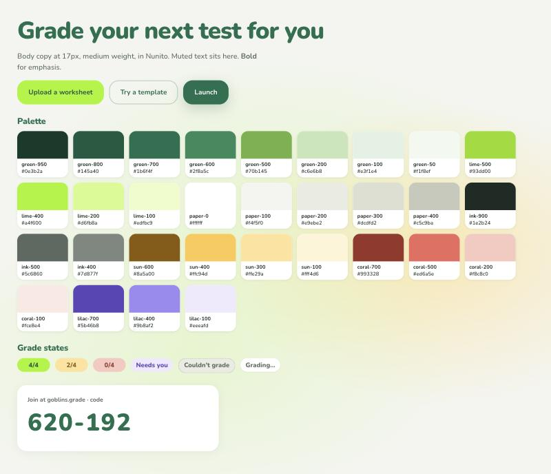

# Design language

The auto-grader should look like part of Goblins, so a teacher who clicks "Try Goblins" from a report lands somewhere familiar. I measured Goblins' public site ([goblins.com](https://goblins.com)) and the start of their app's onboarding ([app.goblinsapp.com/onboard](https://app.goblinsapp.com/onboard)) on 2026-10-15 by reading computed styles in a browser. The numbers below come from those pages. We use none of their logo, illustrations or licensed fonts.



## What Goblins looks like

**Color.** Almost all text on goblins.com is one deep green, `#1B6F4F`, including headings, body copy and outlined buttons. The primary call to action is a loud lime, `#A4F600`, with dark text. Pages sit on a warm off-white, `#F4F5F0`, with sunken panels in `#E9EBE2` and white cards on top. The hero has a soft glow of lime and pale yellow (`#FFE29A`) radial gradients. Coral (`#ED6A5E`) shows up sparingly as an accent. The app's onboarding uses a lighter leaf green (`#70B145` to `#7FC952`) for its primary button and headings.

**Type.** The marketing site uses ABC Ginto Rounded, a rounded geometric sans. Headlines are weight 900, 56 to 64px, with tight tracking (-0.03em). Body copy is weight 500 at 17 to 18px, which is heavier than most sites and reads as friendly. The app uses a custom font ("Goblino"). Both are licensed, so we use **Nunito** (variable, OFL, self-hosted through Fontsource). It has the same rounded terminals and goes up to weight 1000.

**Shape.** Everything is rounded. Cards and large buttons use 20 to 22px radii, smaller controls 12px, chips are full pills. Standards tags are small outlined pills. Shadows are faint and wide (`0 4px 20px` at 5% black), with one brand-tinted glow under the main green button.

**Layout.** Generous whitespace, centered headlines, one idea per section, numbered steps in small green circles. The class join code is shown big in a white card on a lime gradient.

**Tone.** Warm and encouraging, never clinical. Real classroom photos, teacher testimonials, and illustrated teacher avatars with round faces. Copy speaks to teachers in plain words ("Open up laptops", "Be in 30 places at once").

## How we apply it

- **Lime for the one action that matters on a screen** (Upload, Launch, Submit). Deep green for secondary actions and headings. Never two lime buttons side by side.
- **Body text is a near-black green** (`--gb-ink-900`), not the brand green. Goblins' marketing pages are short; our dashboard has dense tables, where green body text tires the eye. Headings stay brand green.
- **Grades never use red.** A low score is soft peach with dark coral text. "Needs you" is lilac, a separate hue from the score ramp, so a teacher scanning the grid sees it as a different kind of cell. "Couldn't grade" is grey with a dashed border. Red (`--gb-color-danger`) is reserved for destructive teacher actions such as removing a student.
- **Students see effort-focused copy.** "Your teacher will check this one" instead of an error, and summaries that count problems done before scores.
- **The projector view uses the type scale's top end** (`--gb-text-code`, 80px) so a join code reads from the back of a room.

## Tokens

All tokens are CSS custom properties in [src/tokens.css](src/tokens.css), prefixed `--gb-`. There are two layers:

- Primitives: `--gb-green-700`, `--gb-lime-400`, `--gb-paper-100`, ... Use these only to define semantic tokens.
- Semantic: `--gb-color-*`, `--gb-score-*`, `--gb-text-*`, `--gb-space-*`, `--gb-radius-*`, `--gb-shadow-*`, `--gb-ease-*`, `--gb-duration-*`. Components and apps use these.

Every text token meets WCAG AA (4.5:1) on the page background and on white.

| Pair | Contrast |
|---|---|
| Body text on page | 13.4 |
| Brand green on page | 5.6 |
| Muted text on white | 5.8 |
| Subtle text (placeholders) on page | 4.6 |
| Success text on its soft background | 5.2 |
| Text on lime CTA | 6.1 |
| Score chips (full, partial, low, needs you, couldn't grade) | 6.1, 4.7, 4.9, 5.9, 4.8 |

## Using it

```css
/* Plain CSS */
@import "@goblins/ui/tokens.css";
@import "@goblins/ui/base.css"; /* optional: font, background, headings, focus ring */

/* Tailwind v4: utilities follow the tokens (bg-accent, text-brand, rounded-xl) */
@import "tailwindcss";
@import "@goblins/ui/tailwind.css";
```

Light theme only for now. Classrooms project in bright rooms and teachers grade on school laptops in the default theme, so dark mode is deferred.
